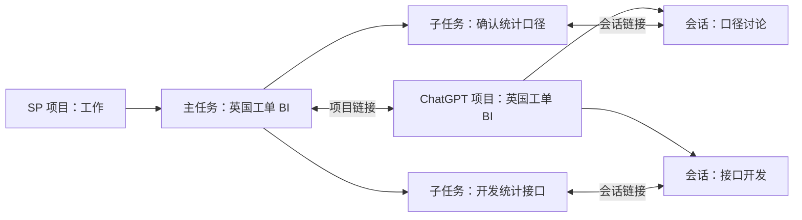

# ChatGPT 项目与任务关联：产品方案

- 状态：Proposed（设计稿，尚未实现或安装插件）
- 负责人：lianliankan007
- 跟踪：[设计分支](https://github.com/lianliankan007/super-productivity/tree/design/chatgpt-project-task-links-20261116)
- 代码核对日期：2026-11-16
- 源码基线：上游 `master`，`2b3f78edbf0721f0842daa097e47247fe245852f`，根包版本 `20.0.0`；版本字段不代表已发布客户端均有这些能力。
- 完成条件：按技术方案完成关联、创建子任务、进度更新和真实 ChatGPT 接入验收；随后将稳定契约迁入维护文档，移除本计划。
- 技术契约：[技术方案与实施计划](2026-11-16-chatgpt-task-links-technical.md)
- 交互原型：[打开 Demo](../prototypes/chatgpt-task-links/index.html)；[使用与验证](../prototypes/chatgpt-task-links/README.md)。双端均为本地模拟，未接入真实账号。

## 1. 要解决的问题

用户用 Super Productivity 管待办和提醒，用 ChatGPT 项目保留某项工作的背景、资料与讨论。目前两者需要靠记忆对应，进入某次讨论时也不容易找到对应的执行任务。

本次默认关系是：**一个 Super Productivity 主任务关联一个 ChatGPT 项目；该项目中的会话按需关联主任务下的子任务。** 不把 Super Productivity 自身的项目容器等同于 ChatGPT 项目。

### 术语

| 名称 | 含义 |
| --- | --- |
| SP 项目 | Super Productivity 的原生任务容器，如“工作”“个人”；工具参数称 `spProjectId` |
| 主任务 | 原生顶层 Task，是本方案的工作主体 |
| 子任务 | 原生 Task 的第二层；不支持第三级任务 |
| ChatGPT 项目 | ChatGPT 内组织会话、文件和项目指令的空间 |
| ChatGPT 会话 | 项目内的一次讨论；绑定会话链接不等于复制会话内容 |
| 关联 | 保存资源链接与任务的对应关系；不授予目标资源访问权限 |

## 2. 参考产品（Prior art）

以下均于 **2026-11** 核对官方资料或源码，未进行这些产品的登录实测。先比较交互，再决定本方案的形态。

| 产品 | 任务与讨论如何对应 | 上下文如何打开 | 本方案借鉴 |
| --- | --- | --- | --- |
| [ChatGPT Projects](https://help.openai.com/en/articles/10169521-projects-in-chatgpt) | 项目组织会话、文件、指令；项目聊天可调用连接的应用 | 项目和聊天页面 | 项目承担持续工作的背景，会话承担具体讨论 |
| [Todoist](https://www.todoist.com/help/todoist/features/add-comments-or-files-to-tasks-in-todoist-CwiA50) | 任务评论与项目评论分别保留不同层次的讨论和附件 | 在对应任务或项目中查看上下文 | 区分工作整体与具体执行项，不把所有材料放到同一条备注里 |
| [Linear × Intercom](https://linear.app/docs/intercom)、[附件接口](https://linear.app/developers/attachments) | 从会话创建或关联 issue；会话以链接附件出现在 issue 上；同一 issue 与 URL 可幂等关联 | 通过外部链接回到会话 | 同时提供“新建”与“关联已有”，按任务与 URL 去重 |
| [Super Productivity 源码](../../src/app/features/tasks/task-attachment/task-attachment.model.ts) | 已有主任务、子任务、LINK 附件 | 原生附件可打开外部地址 | 优先复用原生附件与两层任务模型 |

采用：按需关联、双向导航入口、任务与 URL 去重、写入前展示目标任务。

不采用：复制全部聊天记录、常驻提醒面板、自动扫描用户全部项目、自动把每次聊天变成任务。它们增加数据暴露和操作噪声，且并非本次用户诉求。

对应产品原则：这是个人工作的上下文衔接，属于开发集成与扩展能力；不扩成团队协作平台。默认离线可用、外发关闭；不改变现有提醒设置。[市场目标](../market/README.md#target)与[功能评审规则](../feature-review-guide.md)仍适用。

## 3. 关联规则

1. 默认一个主任务关联一个 ChatGPT 项目，子任务可关联该项目里的会话。
2. 允许多个主任务关联同一 ChatGPT 项目，以覆盖“一个项目有多项独立工作”的情况；查询时列出候选，不能静默选择第一个。
3. 允许一个任务关联多个项目或会话，但第二个项目必须由用户明确选择“追加”；默认绑定遇到已有不同项目时提示选择，不能覆盖。
4. 一次会话可以产生多条子任务，一条子任务也可以关联多次讨论；不存在全局一对一约束。
5. 会话不必建立任务，已有任务也不必有会话。
6. 子任务通过 `parentId` 继承主任务的项目背景。不给每个子任务复制主任务的项目附件；读取时合并显示“直接关联”和“来自主任务”。
7. 默认子任务的会话属于主任务关联的项目；MVP 无法自动证明归属，显示“归属由用户确认”，不能把用户声明包装成平台验证。跨项目讨论可显式关联。
8. 不根据任务名或项目名匹配身份；同名对象必须使用明确任务 ID 与链接区分。
9. 不根据“讨论结束”“已回复”或模型判断自动完成任务。只有明确更新指令才改状态。
10. 原生两层模型保持不变：在子任务会话中继续拆分工作时，新增为同一主任务下的同级子任务，或由用户另建主任务，不伪造第三级。

## 4. 核心使用流程

### 4.1 将任务绑定到 ChatGPT 项目

在 SP 任务附件里粘贴已有项目链接即可保留可点击入口。正式插件提供“关联 ChatGPT 项目”操作：选主任务、粘贴项目链接、核对名称后保存。

插件返回主任务卡片，包含主任务标题、关联项目、完成状态、子任务数量及“查看子任务”。首次绑定时可复制一段项目指令，供用户自己放入 ChatGPT 项目设置：

> 本项目的任务关联入口是 Super Productivity，主任务 ID 为 `<明确的任务 ID>`。查询或修改前使用插件核对该任务；存在多个候选时让我选择。根据讨论建立子任务需要我的明确指令，不把聊天中的普通清单自动写入任务。

项目指令用于帮助选工具，**不是权限控制或可信的项目身份**；后端仍核对连接授权与任务范围。

### 4.2 从会话创建子任务

示例：“把这次讨论整理成两个子任务，放到英国工单 BI 下面，并关联这个会话。”

1. 插件读取明确选定的主任务及其项目关联。
2. 当前会话链接不可自动取得时，请用户粘贴一次；不能猜测 URL。
3. 生成待保存列表：标题、主任务、会话链接、可选估时和计划日。
4. 用户可以编辑列表；调用写工具受 ChatGPT 的确认设置约束。
5. 按不可变草稿执行，返回每一项结果和任务 ID。超时项显示“结果待核对”，不得显示“创建失败，请直接重试”。

初版不自动写聊天摘要；只有用户明确选择“同时保存摘要”才将该段内容写入任务备注。只传完成操作所需的信息。

### 4.3 关联已有任务

示例：“这次聊天就是‘确认统计口径’的讨论，不要再新建任务。”

选择或搜索已有任务，核对主任务后附加会话链接。重复绑定同一个规范化 URL 返回原关联，不新增附件、不覆盖标题或备注。

### 4.4 查询和更新

- “这个项目还有哪些任务？”：当前项目身份不明确时先选关联项目或主任务；查询范围不能来自模型臆测。
- “把接口开发标记完成”：解析到确切任务后执行，展示原状态和新状态；父任务是否完成沿用 SP 原生行为，测试后写清，不另做完成推断。
- SP 端点击链接打开 ChatGPT 项目或会话；用户自行登录并满足目标权限。
- ChatGPT 端首版提供任务 ID 和详情卡。按任务 ID 打开桌面 App 的深链接需另做验证，未验证前不展示一个虚构的跳转地址。

## 5. 产品界面

### SP 端

首版复用任务已有的附件区域，项目与会话都显示为可点击链接。增加关联操作时放进任务菜单或可选插件入口，不给长任务列表每行添加常驻状态、计数或额外网络请求。

可选的后续插件面板只展示选中任务：关联项目、关联会话、添加、解除、复制。快捷键行为沿用原生附件编辑，不抢占现有快捷键。

### ChatGPT 端

先完成文本工具闭环；再增加可选内联卡片。卡片包含主任务、子任务列表、关联链接、状态与创建预览。接口和写权限在服务端校验，不能仅依赖卡片按钮。

MVP 只在本轮明确选择目标；不会依靠一个服务端全局 `currentProject` 保存“当前项目”，以免并发聊天串到另一项工作。跨聊天使用时重新传入目标，或利用项目指令中的任务 ID 再核对。

## 6. 现有能力与交付边界

| 能力 | 核对结果与范围 |
| --- | --- |
| SP 查询、创建、修改任务 | 主分支本地 REST API 已有；需运行 Electron 并主动开启、配置本机 token |
| SP 创建子任务 | REST `POST /tasks` 支持 `parentId`，且禁止三级嵌套 |
| SP 保存可点击项目、会话链接 | 原生 LINK 附件已有；REST 不能直接写 `attachments`，需要窄接口 |
| SP 自带 MCP | 已有任务读取和 Inbox 新建；不能据此宣称已有任意项目下创建子任务和修改状态的授权 |
| ChatGPT 调用外部工具 | 官方支持自定义 MCP；本机服务需使用可达的 HTTPS 或 Secure MCP Tunnel，具体账号权限待接入验证 |
| 自动获取当前 ChatGPT 项目、会话 ID | 本次核对的公开组件接口未发现对应保证；MVP 用显式选择或粘贴链接 |
| 自动创建项目、移动会话、读取整个项目历史 | 不纳入 MVP，也未验证有可供本插件使用的通用公开接口 |
| 静默双向同步聊天全文 | 不实现；任务状态来自 SP，聊天内容保持在 ChatGPT |
| 无人值守定时提醒 | 沿用 SP 本身的提醒；不默认创建 ChatGPT 自动化 |

## 7. 生命周期与异常

| 场景 | 行为 |
| --- | --- |
| SP 没启动或未启用 REST | 返回连接不可用；关联链接仍可离线查看；不在内存排队写入 |
| 任务被归档 | 可查询关联；默认禁止对归档任务写入，提示先恢复 |
| 任务被删除 | 返回任务已不存在；不因重试自动重建 |
| ChatGPT 项目或会话删除、失去权限 | 保留链接，用户可解除；插件不凭打不开判断已删除 |
| 会话被移到别的项目 | 关联链接仍指向该会话；不自动重挂主任务 |
| 同一 URL 在两个主任务下出现 | 查询返回两条候选，要求明确目标 |
| 同名任务 | 用任务 ID、父任务与 SP 项目区分 |
| 任务重命名或移到别的 SP 项目 | 关联跟随任务 ID；不按名称重新绑定 |
| 原生附件被编辑或删除 | 下一次读取以任务当前附件为准；不悄悄恢复已删除关联 |
| 任务复制或重复任务生成新实例 | 可能复制附件；不得把复制后的链接当唯一身份。重复任务的自动关联操作首版拒绝，待明确模板与实例语义 |
| 多设备并发修改同一任务附件 | 沿用原生任务字段冲突机制；有冲突时重读、显示实际结果，不宣称跨设备强一致 |
| 断开插件或解除关联 | 解除只删除对应链接附件；不删除任务、ChatGPT 项目或会话 |

## 8. 验收标准

- AC01：主任务绑定项目后，重启 SP 仍能打开链接；不改标题、备注和提醒。
- AC02：从一段会话建立两条子任务，均在指定主任务下，且各有同一会话链接。
- AC03：已有关联的相同任务与 URL 重试不会新增附件。
- AC04：一个 ChatGPT 项目能关联两个主任务；插件查询时要求选择，绝不静默写错目标。
- AC05：一段会话可绑定两条子任务；子任务可追加第二次讨论链接。
- AC06：有同名任务、两个并发聊天、或缺少项目链接时，不依赖名称或服务端全局当前项目写入。
- AC07：只读连接不能创建、修改或解除关联；授权根任务以外的 ID 被拒绝。
- AC08：创建请求在响应丢失后按操作 ID 核对；不能因自动重试得到重复子任务。
- AC09：删除、归档、过期草稿、断网与连接失效都有准确结果；不能把本机保存描述为全设备已同步。
- AC10：卸载插件、关闭桥接后，任务和普通链接仍可使用；旧客户端能把新关联显示为普通 LINK 附件。
- AC11：实际 ChatGPT 项目中完成一次查询、一次创建预览与执行、一次状态更新；记录账号可用接入方式和工具结果。
- AC12：手机和另一台已同步客户端可看到并打开普通关联链接；远程写入依赖主机在线的限制明确可见。

## 9. 已选默认与待验证项

已选默认：任务为主、项目为背景、会话按需变成子任务；个人单写入主机；手动粘贴链接；原生链接附件是唯一关联事实；创建先预览；状态更新需明确指令。

实施前只剩技术验证：真实账号的私有 MCP 接入能力、真实项目和会话链接格式、链接附件多端兼容、任务创建与附件同一操作的重放结果，以及本机请求超时后的恢复行为。验证不通过时调整实施路线，不能绕过为抓取登录态或使用未公开 ChatGPT 接口。
