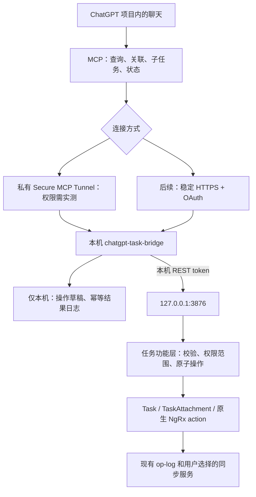

# ChatGPT 项目与任务关联：技术方案与实施计划

- 状态：Proposed（配套独立交互原型，未修改主应用或接入真实账号）
- 负责人：lianliankan007
- 跟踪：[设计分支](https://github.com/lianliankan007/super-productivity/tree/design/chatgpt-project-task-links-20261116)
- 最近核对：2026-11-16，上游 `2b3f78edbf0721f0842daa097e47247fe245852f`
- 完成条件：本文阶段 A—D 验收通过后，将 API 契约与使用限制迁入维护文档，移除本计划。
- 需求与验收：[产品方案](2026-11-16-chatgpt-task-links-product.md)

## 1. 架构选择

采用 **原生链接附件 + 本机 MCP 桥接包 + 可选 ChatGPT 卡片**。



关联的唯一事实是 Task 的 LINK 附件；不新建一份会跨设备冲突的关系数据库，不在 `notes` 中藏 JSON，不直接修改 IndexedDB 或 SuperSync 加密数据。

桥接包的本机日志只负责草稿与操作恢复，不是关联真相。删除日志不会删除关联，但未完成操作必须人工核对。桥接进程需要 SP 主机在线；将包部署到服务器不能自动访问用户电脑的 `127.0.0.1`。

### 方案比较

| 路线 | 结论 | 原因 |
| --- | --- | --- |
| 仅贴链接附件 | 阶段 A 直接可用的最小流程 | 能导航，不能在 ChatGPT 完成子任务写入闭环 |
| 仅接现有内置 MCP | 不足以完成本需求 | 当前只读和 Inbox capture 能力不能替代子任务、关联与状态写入 |
| 扩展内置 MCP 的全部写权限 | 后续再评估 | 会改变已有助手凭据的授权契约；首版不扩大旧 scope |
| SP 插件存一大段同步 JSON | 不采用 | 每次更新整块关系会增加并发覆盖，桥接还需要另一套访问该存储的通道 |
| 给 Task 新增 ChatGPT 专用字段 | 不采用为首版 | 已有附件足以存 URL；新持久化字段会增加旧客户端和协议维护成本 |
| 抓取 ChatGPT 页面或调用内部接口 | 不采用 | 不属于已验证的公开扩展契约，也不需要保存登录 Cookie |

## 2. 源码依据与改造入口

| 代码 | 已验证事实 / 计划用途 |
| --- | --- |
| [`task.model.ts`](../../src/app/features/tasks/task.model.ts) | 原生任务已有 `parentId`、`subTaskIds`、`attachments` |
| [`task-attachment.model.ts`](../../src/app/features/tasks/task-attachment/task-attachment.model.ts) | LINK 可用 `id/type/path/title/icon` 表达 |
| [`task-attachment.service.ts`](../../src/app/features/tasks/task-attachment/task-attachment.service.ts) | 添加附件会重新生成 nanoid；不能直接用它保留方案中的确定性 ID |
| [`task.reducer.ts`](../../src/app/features/tasks/store/task.reducer.ts) | 已有附件添加、修改、删除处理；不新增持久化 action 字符串 |
| [`task.service.ts`](../../src/app/features/tasks/task.service.ts) | `createNewTaskWithDefaults` 可显式指定 `id`；不得为了新需求继续扩大已超长服务 |
| [`local-rest-api-task-routes.service.ts`](../../src/app/features/tasks/local-rest-api-task-routes.service.ts) | `POST /tasks` 支持 `parentId`；允许字段里没有 `attachments`，不能假设 PATCH 能写附件 |
| [`local-rest-api-feature-bridge.service.ts`](../../src/app/features/tasks/local-rest-api-feature-bridge.service.ts) | 字面标题子任务创建已走 `addSubTask`；为新命令构造含附件的完整 Task 提供参考 |
| [`local-rest-api-feature-routes.ts`](../../src/app/core/electron/local-rest-api-feature-routes.ts) | 功能侧注册路由，避免 core 依赖 feature |
| [`electron/mcp/mcp-tools.ts`](../../electron/mcp/mcp-tools.ts) | 内置 MCP scope、投影和响应大小限制；保持现有授权不变 |
| [`parse-app-uri-task-action.ts`](../../src/app/features/tasks/util/parse-app-uri-task-action.ts) | 现有 URI action 不是按 ID 打开任务的完整导航协议；不编造任务跳转 URL |
| [`plugin-api/src/types.ts`](../../packages/plugin-api/src/types.ts) | 后续可用菜单、侧栏、选中任务和持久化能力；首版不改变 public Plugin API |

实现前继续遵守[同步贡献契约](../sync-and-op-log/contributor-sync-model.md)：一个必须原子重放的状态变化对应一个 operation；remote/replay 不再次触发外部写入。

## 3. 数据表示和兼容

### 3.1 关联附件

沿用现有字段，示意数据中的 URL 为占位说明，不是承诺的 ChatGPT URL 模板：

```json
{
  "id": "cg-p-<sha256-of-normalized-url>",
  "type": "LINK",
  "path": "<用户复制并通过校验的真实 ChatGPT 项目 HTTPS URL>",
  "title": "ChatGPT 项目：英国工单 BI",
  "icon": "open_in_new"
}
```

- 项目关联 ID 使用 `cg-p-` 前缀，会话使用 `cg-c-`；摘要使用完整 SHA-256 十六进制。ID 只是现有字符串字段，不增加模型或 schema 版本。
- 同一任务中按 `kind + canonicalUrl` 去重；同一 URL 可在其他任务中存在。显示标题可修改，不承担身份。
- 读取不能只信 ID 前缀，必须重新验证 `type`、HTTPS 主机与 URL；不合规条目退化为普通附件，提示重新关联。
- 规范化仅处理已验证无语义差别的部分，如主机大小写和经过样本证明的跟踪参数。不得默认删除未知 query、改变路径大小写、剥离租户信息或合并 share 链接与私有链接。
- 用户粘贴的项目/会话链接格式在阶段 A 收集真实样本后确定；未识别格式返回 `UNSUPPORTED_TARGET_URL`，保留手动普通附件能力。首版不支持公开分享快照作为“当前会话”身份。
- 新增或替换关联以单次原生 task update 写完整附件结果；保留所有非本操作目标附件。旧客户端照常显示普通 LINK；本功能关闭后链接保持可用。
- 手动已有附件作为候选，用户确认“纳入关联”后在一次 task update 中转换 ID，不能在原附件旁静默新增重复项。
- 默认每条任务最多 20 条受管关联，每个 URL 最长 4096 字符、显示标题最长 200 字符；达到上限要求整理。限制只针对本功能写入，不清理用户原有普通附件。

### 3.2 关系查询

返回 `taskId`、`parentTaskId`、`spProjectId`、`directLinks`、`inheritedProjectLinks`。从主任务推导子任务归属，不维护额外索引列表。MVP 在已授权的任务集合上读取并按 URL 匹配；一个项目返回多个任务是正常结果。

单次查询最多读取 1000 个授权任务、返回 50 项，超出返回 `truncated: true` 要求缩小范围；原生 `GET /tasks` 没有分页保证，不能虚构分页参数。阶段 A 测量真实响应和大列表开销，超出可接受范围时先补有界查询接口，再开放更大数据集。

## 4. 本机 REST 增量契约（拟新增）

以下地址均为**待实现**，复用原有本机监听与 Bearer token；token 不返回给 ChatGPT，也不提交到仓库。不把 `attachments` 加进通用 PATCH 白名单。

| 方法与路径 | 输入 | 输出和语义 |
| --- | --- | --- |
| `GET /integrations/chatgpt/tasks/:taskId/links` | 已授权的确切任务 ID | 直接与继承关联、父任务信息、`revision` |
| `PUT /integrations/chatgpt/tasks/:taskId/links` | `kind`、`url`、`title?`、`mode: ensure / append / replace`、`expectedRevision` | 仅更新目标关联，返回附件 ID 和实际 revision；ensure 相同 URL 无操作 |
| `DELETE /integrations/chatgpt/tasks/:taskId/links/:linkId` | `expectedRevision` | 只删目标受管附件；重复删除返回 `alreadyAbsent` |
| `PUT /integrations/chatgpt/subtasks/:commandId` | `parentTaskId`、`title`、`conversationUrl?`、`notes?`、`estimateMinutes?`、`dueDay?` | 用固定命令 ID 创建含会话链接的完整子任务；返回 taskId 与保存结果 |
| `PUT /integrations/chatgpt/tasks/:taskId/completion` | `isDone`、`expectedIsDone` | 在 renderer 同一执行段核对当前状态并修改，避免桥接先读后调通用 PATCH 的本机竞态；相同目标状态返回无操作 |

通用响应沿用 `{ok:true,data:...}` / `{ok:false,error:{code,message}}`，另附可机器判断的错误详情。参数未定义字段拒绝；外部标题使用字面值，关闭 short syntax，不把 `#tag/+Project/@date` 意外解释成操作。

| HTTP 状态 | 错误码 | 调用方处理 |
| --- | --- | --- |
| 400 | `INVALID_INPUT / UNSUPPORTED_TARGET_URL / INVALID_PARENT` | 更正输入；不重试原参数 |
| 401 / 403 | `UNAUTHORIZED / OUT_OF_SCOPE` | 恢复认证或由用户扩大本机授权；不能换任务 ID 绕过 |
| 404 | `TASK_NOT_FOUND / TARGET_REMOVED` | 刷新目标；不能自动重建 |
| 409 | `BINDING_EXISTS / REVISION_CONFLICT / STATE_CONFLICT / IDEMPOTENCY_CONFLICT` | 重读并明确选择；不覆盖 |
| 410 | `EXPIRED_DRAFT` | 重新准备预览；不能悄悄重用旧草稿 |
| 413 / 429 | `LIMIT_EXCEEDED / RATE_LIMITED` | 缩小范围或按提示稍后操作；不拆分成无界循环 |
| 503 | `APP_NOT_READY / CONNECTION_UNAVAILABLE` | 用户启动 SP 或修复连接；写入仍按 commandId 核对 |
| 504 | `OUTCOME_UNKNOWN` | 查询预定 taskId 与操作日志，不当作“未写入” |

桥接独立限制每连接每分钟 30 次写入；读结果按条数和 256 KiB 响应上限截断，备注默认省略。限流返回重试时间；创建结果未知时，等待时间结束也不构成可以盲目重发的理由。

链接 `revision` 是当前附件集合规范化序列的摘要；同一主机串行执行每个 task 的校验与 dispatch。此比较只防本机旧快照覆盖，**不是跨设备 compare-and-swap**。远端同步可能在完成后覆盖同一字段，返回同步未确认并在下次读取显示实际状态。不能声称多端强一致或全局唯一。

替换主项目时默认返回 `BINDING_EXISTS`；用户明确选择 replace 才执行。多个项目或多次会话使用 append。子任务继承的关联不允许在子任务接口删除，必须定位原主任务。

### 创建子任务的原子性

`commandId` 为桥接生成的 UUID；在私有命令路径内按桥接安装命名空间与 commandId 派生保留前缀 taskId。一次 `addSubTask` action 携带完整 Task 和初始 LINK 附件，不采用“先创建，再另加附件”的两步成功承诺。

执行前检查：父任务存在且为顶层、未归档、未完成、无重复模板绑定歧义；继承其 SP 项目，子任务 `tagIds` 为空；不受当前打开视图影响。显式计划日通过原生日期校验，时间单位在桥接层转换为毫秒。

相同 commandId 查到已有预期 taskId 且创建载荷指纹一致时返回原结果；指纹冲突返回 `IDEMPOTENCY_CONFLICT`。载荷指纹由本机操作日志保存，不添加到同步 Task。日志缺失或窗口已过时拒绝自动重放，不能仅凭“ID 未查到”决定新建。

写成功响应必须满足 op-log 持久化屏障并重读结果；未确认持久化返回 `OUTCOME_UNKNOWN`，不能把 dispatch 成功当落盘或远端同步成功。具体 barrier 在阶段 A 验证，不能只依赖当前 REST 的成功 envelope。

## 5. MCP 工具契约（拟新增）

桥接作为独立包 `packages/chatgpt-task-bridge/`，自有 package.json、锁文件和验证脚本；不把 MCP SDK 或其他依赖加入根包。根应用继续使用已有机制，不替换现有 MCP 实现。

| 工具 | 关键参数 | 读写与目的 |
| --- | --- | --- |
| `get_connection_status` | 无 | 只读；SP 在线、桥接版本、授权范围；不回显密钥 |
| `find_linked_tasks` | `taskId? / targetUrl? / query?`、`limit?` | 只读；在已授权集合中查候选，任务名只帮助选择 |
| `get_task_context` | `taskId` | 只读；父子关系、关联、状态和 revision；备注另需授权 |
| `bind_chatgpt_link` | `taskId`、`kind`、`url`、`mode`、`expectedRevision` | 写；保存已选定项目或会话关联 |
| `prepare_subtasks` | `parentTaskId`、`items[]`、显式会话链接 | 写本机临时草稿，不修改 SP；返回不可变 draftId、各项预定 taskId、有效期和预览 |
| `apply_subtasks` | `draftId` | 写；按草稿执行，返回逐项结果；不能偷偷改变已预览标题或父任务 |
| `set_task_completion` | `taskId`、`isDone`、`expectedIsDone` | 写；只更新完成状态，先比较旧状态；不接受任意 task patch |
| `unlink_chatgpt_link` | `taskId`、`linkId`、`expectedRevision` | 写；解除关联，不能删除 ChatGPT 资源或 SP 任务 |

读工具标注 `readOnlyHint:true`；其余按实际副作用标注。写工具的确认遵从宿主设置，服务端仍验证授权、草稿和资源归属。不存在自动获取当前项目/会话的隐藏入参。

创建流程示例（都是待实现协议）：

```json
{
  "tool": "prepare_subtasks",
  "arguments": {
    "parentTaskId": "已读取并选定的主任务ID",
    "items": [
      {"title": "确认统计口径", "conversationUrl": "用户提供的真实会话链接", "estimateMinutes": 30},
      {"title": "开发统计接口", "conversationUrl": "用户提供的真实会话链接", "estimateMinutes": 120}
    ]
  }
}
```

`prepare_subtasks` 每次最多 10 项、有效期 30 分钟。每项有独立 commandId；允许部分完成，但整个列表不宣称事务原子。执行失败后保留成功项，后续只恢复未确认项，不回滚删除已经创建的工作。

所有结果区分 `savedLocally`、`syncConfirmed:false` 与 `created / alreadyApplied / conflict / outcomeUnknown`。不同设备是否已看见改动由同步验收证明，不由模型口头确认。

## 6. 本机操作日志与恢复

建议使用 Node.js 24 的 `node:sqlite`，仅在独立桥接包内使用；当前开发机 `node --version` 为 `v24.21.0`，不据此保证分发环境可用。打包前验证运行时及数据库 API 兼容。

拟定三张本机表：

| 表 | 字段与约束 |
| --- | --- |
| `bridge_draft` | `id TEXT PRIMARY KEY`、`connection_id TEXT`、`parent_task_id TEXT`、`payload_json TEXT`、`payload_hash TEXT`、`expires_at INTEGER` |
| `bridge_command` | `id TEXT PRIMARY KEY`、`draft_id TEXT`、`item_index INTEGER`、`task_id TEXT UNIQUE`、`state TEXT`、`payload_hash TEXT`、`result_json TEXT NULL`、`updated_at INTEGER`；唯一 `(draft_id,item_index)` |
| `bridge_connection` | `id TEXT PRIMARY KEY`、`allowed_root_task_ids_json TEXT`、`scopes_json TEXT`、`revoked_at INTEGER NULL`；凭据材料单独存入操作系统凭据设施 |

按 `draft_id`、`expires_at`、`updated_at` 建索引；`state` 只取 `prepared / dispatching / saved / outcome_unknown / conflict`。JSON 与标题、URL 长度由入口限制；不把命令参数串接成 SQL。

执行前事务写入 command 与确定 taskId，然后发送本机命令，最后事务记结果。跨 SQLite 与 SP 无分布式事务：崩溃窗口通过 taskId 重读，永远不盲目重发未知创建。

若 `dispatching` 后重启且 taskId 不存在，无法排除“已创建又被用户删除”，保留 `outcome_unknown` 等待明确处理；不自动重建。重试 saved 操作时若任务已经删除，返回 `TARGET_REMOVED`。

未执行草稿到期删除；成功日志保留 30 天；未知结果不自动删除，提示解决后清理；本机数据库达到 100 MiB 停止新写入并要求整理。日志包含用户预览内容，按用户数据保护并提供清理功能，不能作为诊断日志导出。正文诊断日志仅含 requestId、commandId、taskId、状态、耗时与错误码。

## 7. 连接、授权与隐私

### 首个私用版本

1. 用户主动启动桥接，并在 SP 本机开启 REST；默认不新增公开监听。
2. 阶段 A 核对账号是否可用 Secure MCP Tunnel、自定义 MCP，以及本机私有服务认证如何传递。隧道认证与工具级授权分别验证；不假设隧道会自动传 REST token。
3. 本机 SP token 只由桥接读取，连接 ChatGPT 的凭据与之分离；token 撤销或主机离线立即停止写入。
4. 每个连接按根任务白名单授权，动态派生其子任务；每次调用重新验证父子关系，用户移动任务后不能残留访问权。默认只读；备注读取、新建子任务、状态写入、链接写入分别开启。
5. 不默认允许根任务之外的全量任务搜索。想绑定新主任务时先在本机设置扩大授权范围。

如果私有接入与认证在实际账号不可用，先交付本机关联和本地 MCP 验证；远程闭环保持未验收。另行设计稳定 HTTPS + OAuth 2.1 网关，不将匿名公网转发作为完成状态。

### 后续公开分发

公开插件需要稳定可达的 HTTPS 端点、OAuth 账户隔离和每用户设备路由；私有隧道不能当作公开插件提交方案。公网网关到用户本机的出站代理是独立阶段，不能把 loopback 地址部署在云上就宣称完成。

不收集 ChatGPT Cookie，不获取聊天全集，不自动验证远端项目可见性。只上传用户选择的任务摘要、URL 和操作结果；备注和摘要单独授权。链接不带来访问权限。禁止后端抓取用户粘贴 URL，避免 SSRF 和意外外发。

## 8. 计划文件与实现边界

以下路径是未来实现位置，不表示文件已存在：

| 位置 | 内容 |
| --- | --- |
| `src/app/features/tasks/chatgpt-links/` | 纯 URL 规范化与受管附件识别、命令服务、单元测试 |
| `src/app/features/tasks/chatgpt-links/local-rest-api-chatgpt-routes.service.ts` | 窄路由、旧快照比较、原生任务 action、持久化确认 |
| `src/main.ts` | 在已存在的 multi provider 装配位置注册 `LOCAL_REST_API_FEATURE_ROUTES`，不在 core 引入 feature |
| `packages/chatgpt-task-bridge/` | MCP 工具、连接授权、本机 REST 客户端、SQLite 操作日志、包级测试 |
| `packages/chatgpt-task-bridge/plugin/` | 待验证后制作宿主插件清单与可选技能；按届时官方打包契约生成，不先写假清单 |
| `e2e/tests/` 对应任务、同步测试目录 | 主任务、附件、子任务原子操作、跨设备与旧客户端行为回归 |
| `docs/wiki/3.01-API.md` 等维护文档 | 实际上线接口、数据流与限制；只有实现后才写成已有功能 |

不修改本分支的 AGENTS.md、根依赖、现有 MCP scope 和同步 schema。若实现中必须改变公共类型或新增 action，先更新兼容性评估，再实施。

## 9. 分阶段执行

| 阶段 | 产物 | 退出条件 |
| --- | --- | --- |
| A：能力验证 | 独立测试数据；真实项目/会话链接样本；隧道与认证验证记录；附件兼容、落盘屏障、固定 taskId 原子创建实验 | 证明不依赖 ChatGPT 内部 API；确定真实链接解析规则和可用传输路径 |
| B：SP 端关联 | URL 规则、受管 LINK、窄接口、单次 task action、查询与解除 | AC01、03、04、05、09、10；旧客户端和双设备附件写入实测 |
| C：私用 MCP 闭环 | 独立桥接包、根任务授权、创建草稿、恢复日志、状态写入、私有 ChatGPT 连接 | AC02、06、07、08、11、12；真实项目中执行完整流程 |
| D：体验收敛 | 可选卡片、SP 菜单、安装包、使用文档、故障诊断与清理 | 通过键盘与长列表检查；主机离线、凭据撤销、卸载回退明确 |
| E：公开分发（后续） | OAuth HTTPS 网关、出站设备代理、多用户隔离、插件提交材料 | 单独验证并交付；不作为私用版本的隐含承诺 |

设计分支配套了[独立双边交互原型](../prototypes/chatgpt-task-links/README.md)，演示双向跳转、创建子任务、状态更新与窗口间联动。原型使用虚构数据和浏览器本地存储，不将阶段 A 的账号验证或后续生产代码标记完成。

## 10. 验证与回退

实施时验证矩阵：

- URL：真实项目、普通会话、项目内会话、错误主机、用户名密码段、query/fragment、分享快照、同名不同 URL；拒绝 `javascript:`、`file:`、相似域名。
- 关联：重复 ensure、显式 append、替换冲突、原生附件转换、解除继承关联、删除附件后不复活。
- 创建：两项成功、部分成功、同 commandId 相同/不同载荷、写前断开、dispatch 后响应丢失、持久化后崩溃、日志缺失、任务已被删除、归档和禁止三级任务。
- 授权：只读拒绝写、跨根任务 ID 拒绝、两连接互相不可访问、主任务变更后的权限重算、备注权限关闭。
- 同步：任务与初始会话附件同一 op、remote replay 不重新调用桥接、与其他设备编辑普通附件并发、旧客户端读取与再次保存不丢链接、正常导入导出。
- 产品：实际 ChatGPT 项目里调用工具；不同项目同时聊天不串任务；大列表响应有界；手机仍能点击普通链接。

按根 AGENTS.md 对修改 `.ts/.scss` 跑 `checkFile`；测试通过 `npm run quiet -- ...` 运行。桥接独立包跑自身类型检查与单测，应用侧跑受影响测试；涉及同步使用真实数据形态的 E2E。实际同步 PR 在 ready 前执行仓库要求的独立上下文子代理审查；本次仅文档设计，无运行时同步 PR。

回退：先停止并撤销桥接连接，再撤回新增代码；保留既有 LINK 附件作为普通链接。解除只影响关联附件。不要清空任务、同步库或用户备注。本机日志包含未确认操作时先导出受保护的恢复记录并人工核对，不能直接删除后重新创建。

## 11. 外部依据与不确定性

核对日期均为 2026-11-16；以下是平台能力证据，不证明当前账号已有入口，也不证明已经完成联调。

- [ChatGPT Projects](https://help.openai.com/en/articles/10169521-projects-in-chatgpt)：项目内使用连接应用；项目、会话、资料的组织关系。
- [自定义 MCP](https://developers.openai.com/api/docs/guides/custom-mcp-server)：工具读写与账号/工作区限制。
- [连接与测试插件](https://developers.openai.com/plugins/deploy/connect-chatgpt)：HTTPS 或 Secure MCP Tunnel，先验证工具再打包。
- [Secure MCP Tunnel](https://developers.openai.com/api/docs/guides/secure-mcp-tunnels)：私有接入、权限和运行前提；公开分发另需稳定端点。
- [组件接口](https://developers.openai.com/plugins/reference)：本次检索未找到自动读取当前项目 ID / 会话 ID 的公开保证；显式 URL 是降级路径，不把“未找到”描述为平台永远不支持。
- [MCP UI](https://developers.openai.com/plugins/build/chatgpt-ui)：工具不依赖 UI，后续按 MCP Apps 标准增加内联卡片。

上游关闭 issue 以 `ChatGPT` 关键词做过初步检索（15 项，结果包含无关条目），不足以证明社区普遍需要本功能或上游已接受该方向。本 fork 的直接需求来自本次用户；不把私用方案包装成上游产品决策。正式提 upstream PR 前需重新检索对应议题与拒绝理由。

当前 Codex 宿主提供的内置项目管理工具，也不能视为第三方插件会获得相同接口或权限；实现只依赖公开契约与实测后的连接方式。
