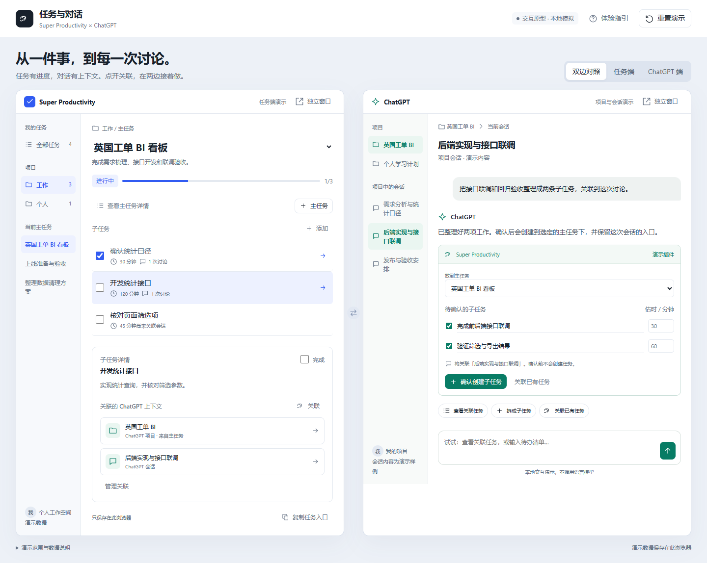

# 任务与对话：双边交互 Demo

**优先体验新版：[完整原生应用版](native/README.md)**，本机入口为 [4179](http://127.0.0.1:4179/native/)。新版保留原生 Web 应用及扩展，通过插件创建和更新真实任务、双向跳转；ChatGPT 一侧仍为模拟。下文的单文件版本作为早期交互原型保留。

这是一个独立交互原型，使用虚构示例数据，**未接入真实 ChatGPT、Super Productivity、MCP 或账号**。写入只保存在当前浏览器，跳转只打开原型中的对应视图。



## 打开

直接打开 [index.html](index.html) 可离线体验，无 CDN 或外部资源。要稳定体验两个窗口共享状态，建议从此目录运行：

```powershell
node serve.cjs
```

然后访问 [本机 Demo](http://127.0.0.1:4178)。服务只监听 `127.0.0.1`，只提供演示页面；不会读取或暴露仓库其他文件。使用其他端口时设置 `DEMO_PORT`。

## 推荐体验顺序

1. **任务 → 项目**：左侧选中任务，点击“关联的 ChatGPT 上下文”中的项目，右侧进入项目首页。
2. **子任务 → 会话**：点击子任务右侧箭头，右侧打开确切的讨论。
3. **会话 → 新子任务**：选择主任务，编辑草稿标题、估时，确认创建；左侧增加子任务。
4. **会话 → 具体任务**：创建结果点击“查看任务”，左侧定位这条子任务，能看到原会话链接。
5. **两边更新状态**：左侧勾选任务；右侧点“查看关联任务”看到变化。右侧勾选时先确认，可取消。
6. **关联已有任务**：当前会话中选择已有任务，重复操作不会增加重复链接。
7. **多种关系**：主任务可以追加多个项目；一个项目也可以关联多条主任务。项目首页有“关联任务”，任务详情有“关联”和“管理关联”。
8. **独立窗口**：两端标题栏点击“独立窗口”，打开各自单端视图；单端的关联链接会切换到另一端，支持浏览器返回。两个标签页共享本地演示数据。
9. **自由输入清单**：在演示输入框每行输入一项待办，得到可编辑的子任务草稿。此处是本地规则演示，不调用语言模型。

右上角“重置演示”仅清除此原型的数据。浏览器禁用存储时显示提示，改动只在本页有效；清除浏览器数据会清除演示状态。

## 设计

- `prototype-web` 模板用于可交互原型与响应式结构；按本次操作演示需求采用双应用工作台，不制作营销落地页。
- 任务端使用钴蓝，项目会话端使用深绿；白底、平面任务行、少量链接卡片，保留两端清晰边界。
- “双边对照 / 任务端 / ChatGPT 端”切换展示方式；URL 中的视图和路由对应真实可打开的原型页面。
- 示例任务、会话与文字均为演示内容，不代表任何环境中的真实需求状态。
- 单文件包含所有 CSS、SVG 与 JavaScript，不依赖应用主包，也不修改现有任务、同步或公共插件 API。

## 回归验证

独立目录拥有自己的开发依赖与锁文件，不向仓库根包增加依赖。使用 Node.js 20 或更新版本，并安装 Chrome：

```powershell
npm ci
npm test
npm run format:check
```

`demo.spec.cjs` 覆盖双向跳转、浏览器返回、创建草稿与持久化、两端状态更新、重复关联、解除关联、项目多任务消歧、独立窗口同步、自定义清单和窄屏布局。测试使用独立浏览器上下文，不操作真实账号。

2026-11-16 本机验证结果：**13 / 13 通过**。使用 Chrome 无头浏览器，覆盖 1920 / 1366 / 768 / 390 像素宽度、文件协议直接打开和本机 HTTP 服务。格式检查通过；预览图由实际页面截图生成。

测试默认复用本机已运行的 `4178` 服务；CI 中由 Playwright 启动服务。截图与 trace 放在仓库 `.tmp/task-links-test-results/`。

## 实现边界

独立窗口的联动使用同源 `localStorage` 和 `storage` 事件，仅演示浏览器窗口之间的共享状态；不构成跨设备、跨服务同步。文件协议的存储行为由浏览器决定，建议通过本机服务体验。草稿执行结果在演示模型中去重，但不是生产级幂等或持久化事务的验证。

真实产品的链接解析、原生任务 API、MCP 认证、权限和异常恢复仍按[产品方案](../../plans/2026-11-16-chatgpt-task-links-product.md)与[技术方案](../../plans/2026-11-16-chatgpt-task-links-technical.md)实施和验收。本原型中的项目与会话导航不证明 ChatGPT 已开放自动获取当前项目或会话身份的接口。
