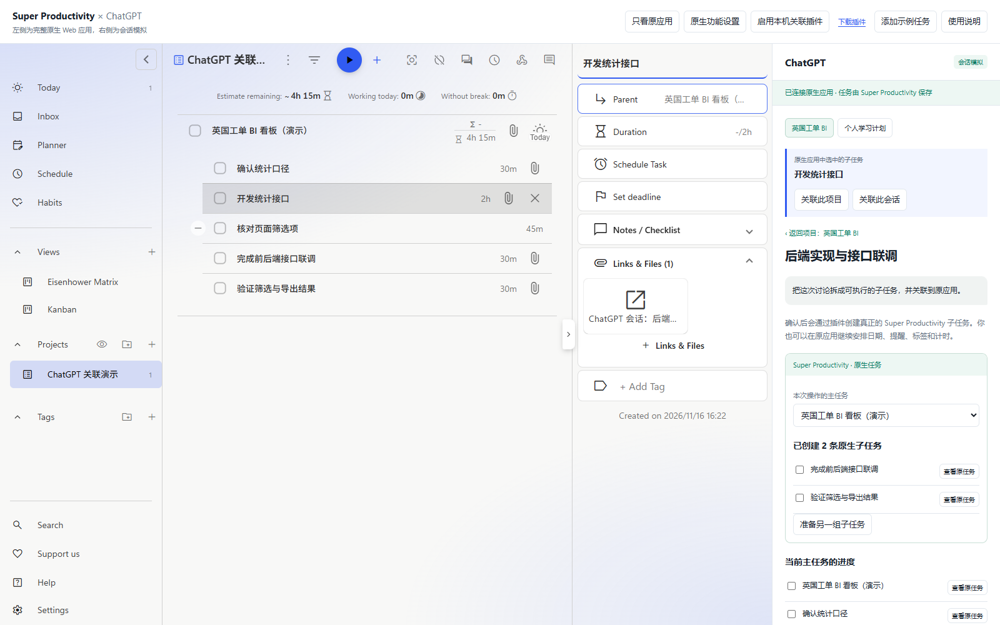

# 完整原应用与 ChatGPT 会话关联 Demo

左侧运行从 fork 源码构建的 **完整 Super Productivity Web 应用**；右侧是本地模拟的 ChatGPT 项目与会话。关联插件通过原生 `PluginAPI` 读写真实任务，任务保存、日期、估时、计时、标签和附件都由原应用处理。没有替换或删减主应用源码，也没有连接真实 ChatGPT 账号、语言模型或 MCP。



## 本机体验

访问 [原生应用版 Demo](http://127.0.0.1:4179/native/)。首次进入：

1. 点击“启用本机关联插件”，在原应用确认框中核对并确认安装。也可下载 ZIP，在原生设置 → 插件中手动安装、启用。
2. 连接后点击“添加示例任务”，生成一个原生项目、一条主任务及三条子任务；再次点击会定位现有示例主任务。
3. 点击“原生功能设置”，按需开启日程、看板、习惯、专注等功能。**原版新安装默认关闭部分功能**，设置修改自动保存；“只看原应用”可收起会话侧。
4. 会话侧编辑草稿、确认创建，左侧增加真实子任务；“查看原任务”会打开原生详情。
5. 点击原生任务详情的 ChatGPT 链接附件，打开独立会话窗口；该窗口可查看原任务、确认更新状态。原应用勾选完成也会反映到会话侧。

可以在原应用创建自己的演示任务，再使用顶部“ChatGPT 关联”图标或任务右键菜单选择上下文。主任务关联项目，子任务关联具体会话；支持追加项目、重复关联去重和仅解除链接。右侧同一项目有多条主任务时需明确选择。

本机服务只监听 `127.0.0.1`。浏览器必须保留原应用窗口，独立会话窗口通过同源 `BroadcastChannel` 请求原窗口操作，不启动第二个任务数据库实例。关闭原窗口后，已有会话窗口不会成为独立任务客户端。

## 从源码运行

在仓库根目录执行，使用根 `package.json` 指定的 Node.js 版本，并安装 Chrome：

```powershell
npm ci
npm run quiet -- build:packages
npm run quiet -- buildFrontend:dev --base-href=/app/ --source-map=false --output-path=.tmp/native-demo-app
npm --prefix docs/prototypes/chatgpt-task-links ci
npm --prefix docs/prototypes/chatgpt-task-links run start:native
```

`build:packages` 包含原有插件构建。服务将 `.tmp/native-demo-app/browser` 映射为 `/app/`，将外层界面映射为 `/native/`。自定义插件 ZIP 由服务动态打包，包含 `plugin/manifest.json` 与 `plugin/plugin.js`。没有给根包新增依赖。可通过 `NATIVE_DEMO_PORT` 调整端口；测试配置使用固定 4179。

## 实现边界

- 原生任务通过 `getTasks/addTask/updateTask/addProject` 操作；关联使用普通 `LINK` 附件，保留既有附件，不直接修改应用 IndexedDB。定位使用原生路由和公开任务选择 action。
- 独立会话窗口和外层界面只保存演示界面状态。任务、估时、完成状态和链接附件由原应用持久化。清除本站点浏览器数据会删除这些本机数据。
- 两个 ChatGPT 项目、四段会话及草稿都是虚构的本地数据，没有自动识别真实 ChatGPT 当前项目/会话。生成草稿不调用模型。
- 创建任务与添加附件是两次原生操作；失败时保留已创建任务。草稿结果用本机操作记录辅助去重，结果未知时需先核对任务，不具备生产级事务或跨设备幂等保证。示例初始化中途失败也应先核对现有示例，不能视为整批回滚。
- 仅读取最多 1000 条活动任务供演示选择；不包含归档任务。原生的第三方账号同步、移动端、Electron 专属能力和真实 MCP 接入未在本次验收中验证。
- 消息仅限本站点同源窗口；外层与插件通信检查来源窗口和会话令牌。这是本机演示，不应直接当作公网账号认证或多用户桥接服务。

## 验证

```powershell
npm --prefix docs/prototypes/chatgpt-task-links run quiet -- test:native
npm --prefix docs/prototypes/chatgpt-task-links run quiet -- format:native:check
```

`native.spec.cjs` 使用独立无头 Chrome 上下文，执行真实 ZIP 安装和原生确认，不注入假任务 API 或直接修改数据库。覆盖：

1. 原生任务估时和计时启停；开启功能并刷新保存，进入计划、日程、看板、历史和统计；插件列表至少 25 张卡片，包含原版扩展与自定义插件；收起会话侧。
2. 创建两个真实子任务，原生附件打开独立会话，双向完成状态更新、返回定位、刷新后持久化和重复初始化不重建任务。
3. 会话关联去重、追加项目与解除链接，原生任务保留。

2026-11-16：完整前端构建与原有插件构建通过，三个集成场景通过；预览图来自实际页面。测试截图与 trace 位于仓库 `.tmp/native-demo-test-results/`，不提交生成的应用构建和浏览器数据。

推送前另通过 `packages:test`（sync-core 293、shared-schema 95、sync-providers 476，共 864 个测试）及 shared-schema 构建。本机 Windows 的两个真实 Git 临时仓库测试曾因启动子进程和全局 hooks 超过默认 5 秒而超时，已仅对这两个场景设置 Windows 30 秒时限，保留全部断言；该包按仓库规则使用自身构建与测试验证，不把 root ESLint 的忽略结果当作通过。

真实 ChatGPT 与本机 MCP 桥接后续按[产品方案](../../../plans/2026-11-16-chatgpt-task-links-product.md)和[技术方案](../../../plans/2026-11-16-chatgpt-task-links-technical.md)实施。
